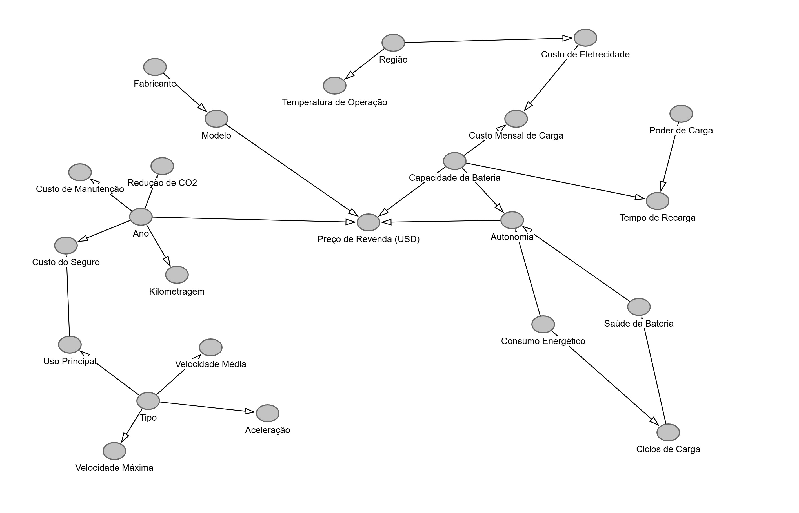

<h1 align="center">Valor de Revenda de Veículos Elétricos: Previsão e Inferência Causal</h1>

<p align="center">
Projeto de conclusão de curso da <b>Alura</b> · Python · scikit-learn · XGBoost
</p>

## Visão geral

Este projeto investiga quais fatores técnicos determinam o **valor de revenda (em US$) de veículos elétricos** e constrói um modelo para prevê-lo.

Em vez de jogar todas as 25 variáveis disponíveis em um algoritmo, o ponto de partida é um **DAG (Grafo Acíclico Direcionado)** que mapeia as relações causais esperadas entre as variáveis. Ele orienta a escolha das *features*, ajuda a evitar viés de variável omitida e deixa explícitas as premissas do estudo.

<p align="center">
  
</p>

## Principais resultados

| | |
|---|---|
| **Modelo final** | Regressão linear com 2 variáveis: Capacidade da bateria e Ano |
| **R² (teste)** | 0,907 |
| **MAE (teste)** | ~US$ 1.508 |
| **+1 kWh de bateria** | ~US$ 198 a mais no valor de revenda |
| **+1 ano de fabricação** | ~US$ 474 a mais no valor de revenda |

**O que a análise mostrou:**

1. **Capacidade da bateria e ano de fabricação explicam ~90% da variação do preço.**
2. **Modelos complexos não superam uma regressão linear simples.** XGBoost, Random Forest, SVR e Elastic Net foram ajustados com `GridSearchCV` e comparados por validação cruzada; nenhum foi melhor que a regressão linear com duas variáveis. O Elastic Net, quando bem regularizado, chega sozinho a esse mesmo modelo, zerando os demais coeficientes.
3. **Autonomia e capacidade da bateria são quase redundantes** (correlação de 0,94; ~5 km por kWh). Por isso, o efeito da autonomia "some" quando a bateria está no modelo. Isso é colinearidade, não ausência de efeito.
4. **Modelo e fabricante não têm efeito relevante** depois de controlar por bateria e ano.

### Comparação dos modelos (validação cruzada, 5 *folds*, conjunto de treino)

| Modelo | R² | MAE (US$) | RMSE (US$) |
|---|---|---|---|
| **Regressão linear (bateria + ano)** | **0,899 ± 0,004** | **1.545 ± 24** | **1.767 ± 26** |
| Elastic Net (4 variáveis) | 0,899 ± 0,004 | 1.545 ± 25 | 1.767 ± 27 |
| SVR (4 variáveis) | 0,895 ± 0,004 | 1.564 ± 23 | 1.801 ± 23 |
| Random Forest (4 variáveis) | 0,892 ± 0,004 | 1.570 ± 26 | 1.827 ± 33 |

O XGBoost fica na mesma faixa (R² ≈ 0,90 no conjunto de teste); a tabela completa, incluindo ele, é gerada no notebook.

## Limitações

Variáveis que normalmente pesam muito no preço de um carro usado (quilometragem, saúde da bateria, ciclos de carga) **não têm relação** com o valor de revenda neste conjunto, e os resíduos do modelo têm distribuição **uniforme**, típica de ruído artificial. Isso indica que o **dataset é provavelmente sintético**: as conclusões valem para estes dados e não devem ser extrapoladas diretamente para o mercado real.

O DAG representa premissas do autor; a interpretação causal depende de essas premissas estarem corretas.

## Metodologia

1. **Tradução e limpeza:** colunas e categorias traduzidas para o português.
2. **Análise exploratória:** correlação de Spearman (captura relações monotônicas não lineares), boxplots por categoria e evolução das variáveis por ano e fabricante.
3. **Seleção de variáveis guiada pelo DAG:** Modelo, Ano, Autonomia e Capacidade da bateria.
4. **Prevenção de vazamento de dados:** `train_test_split` antes de qualquer transformação; padronização e *one-hot encoding* feitos dentro de um `Pipeline` com `ColumnTransformer`.
5. **Modelagem:** *baseline* linear + quatro modelos ajustados com `GridSearchCV` (5 *folds*).
6. **Comparação robusta:** validação cruzada com média e desvio padrão, em vez de um único *split*.
7. **Diagnóstico:** análise de colinearidade e de resíduos.
8. **Entrega:** o pipeline final é salvo com `joblib`, com exemplo de uso no notebook.

## Estrutura do repositório

```
├── revendaCarros.ipynb                # notebook com toda a análise
├── electric_vehicle_analytics.csv     # dados (3.000 veículos, 25 colunas)
├── DAG.jpeg                           # grafo causal usado na seleção de variáveis
├── modelo_revenda.joblib              # modelo final treinado
└── requirements.txt                   # dependências
```

## Como executar

```bash
git clone https://github.com/kauanqfranco-cpu/ev-resale-value-regression.git
cd ev-resale-value-regression
pip install -r requirements.txt
jupyter notebook revendaCarros.ipynb
```

### Usando o modelo treinado

```python
import joblib
import pandas as pd

modelo = joblib.load('modelo_revenda.joblib')
carro = pd.DataFrame({'Capacidade_bateria(kWh)': [75.0], 'Ano': [2022]})
print(modelo.predict(carro))  # ~ US$ 23.490
```

> O arquivo `.joblib` deve ser carregado com a mesma versão do scikit-learn listada em `requirements.txt`.
